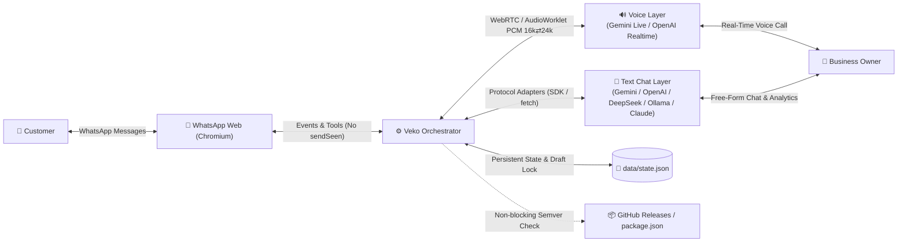

# 🎙️ Veko — WhatsApp Business AI Voice & Text Assistant

**🇬🇧 English** | [🇹🇷 Türkçe](README.tr.md)

[](https://nodejs.org/)
[](#supported-ai-providers)
[](#supported-ai-providers)
[](#architecture)
[](#whats-new-in-v021)
[](LICENSE)

> **Language Optimization Notice:** Veko is currently optimized for **Turkish** (system prompts, WhatsApp commands, and `Europe/Istanbul` calendar analytics). Support and optimizations for English and additional languages will be added and shared progressively.

**Veko** is a 24/7 open-source **WhatsApp Business voice & text executive assistant** built on `whatsapp-web.js`, **Chromium WebRTC / AudioWorklet** audio bridging, and **multi-provider AI**.

When a customer messages your business WhatsApp line, Veko calls the business owner (`OWNER_PHONE`) over WhatsApp Voice (or automatically answers when the owner calls the business line), summarizes the chat history without triggering read receipts ("blue ticks"), and only sends outbound messages after explicit verbal or 2-step written confirmation.

---

## 🧠 Architecture



---

## ✨ Key Features

### 📞 Bidirectional WhatsApp Voice Calling
* **Automated Outbound Calls:** Calls the owner on WhatsApp when a qualifying customer message arrives (respecting cooldown, retry, and active-owner suppression windows).
* **Owner Incoming Call Auto-Answer:** When the owner calls the business line from `OWNER_PHONE`, Veko automatically picks up and reports pending or unread customer chats.
* **No Virtual Audio Cable Required:** Injects a browser-side `WebRTC` + `AudioWorklet` bridge directly into Chromium for bidirectional 16 kHz / 24 kHz PCM audio streaming.
* **Text-Only Mode (`AI_VOICE_PROVIDER=none`):** Disable voice calls and run Veko purely as a silent notification + WhatsApp text assistant.

### 💬 Free-Form WhatsApp Text Assistant & Customer Analytics
* **Calendar Customer Analytics (`get_customer_stats`):** Ask questions via WhatsApp such as *"How many customers messaged this month?"*, *"Who wrote today?"*, or *"Are there unread chats?"* — computed in `Europe/Istanbul` time while excluding outbound-only chats and active third-party suppliers.
* **Context & Contact Lookup:** Search contacts and read chat history (`search_contacts`, `list_recent_chats`, `get_chat_history`) without triggering read receipts.
* **Instant Control Commands:** Quick commands (`durum`, `ara`, `ara <name/phone>`, `sustur <minutes>`, `devam`) run immediately without consuming LLM tokens.

### 🔒 Security, Privacy & Smart Notifications
* **Stealth Read (No Blue Ticks):** Never calls `sendSeen()` when inspecting customer messages or scanning chats.
* **Voice Verbal Confirmation Gate:** Outbound WhatsApp messages require explicit verbal confirmation (`ownerConfirmed: true`) during voice calls and send an audit receipt to the owner.
* **Code-Enforced 2-Step Text Draft Lock:** In text chat mode, `send_whatsapp_message` cannot send in a single turn. It first stages a 15-minute draft (`pendingOutgoingDraft`), shows the exact recipient and message text to the owner, and only sends when the next owner message confirms the exact recipient and text.
* **Verified `@lid` Identity Resolution:** Resolves WhatsApp `@lid` identifiers with reverse `OWNER_PHONE` verification so unknown or unresolved `@lid` calls are never auto-answered.
* **Non-Intrusive Update Notifications:** Sends a one-time setup message upon first installation, applies a 15-minute cooldown to restart notices, and never wakes the owner at night — delivering new release notices only right after an answered call or text chat turn (toggleable via natural language or *"Güncelleme bildirimi kapat"*).
* **Channel Filtering:** Ignores groups (`@g.us`), status updates (`status@broadcast`), broadcast lists, and newsletters (`@newsletter`).

### 🎯 Smart Triage, 10-Min Debounce & Quiet Hours
* **Two-Tier Noise Filtering (`CALL_POLICY=smart`):** Zero-cost rules ignore trivial closings (`"tamam"`, `"teşekkürler"`, pure emojis, stickers) and automated OTP/bank notifications, while the configured text AI triages customer intent (`ignore`, `normal`, `urgent`, `critical`).
* **Sliding 10-Minute Debounce (`CALL_DELAY_MINUTES=10`):** Normal inquiries buffer until the customer finishes texting (resetting per message, cancelling if you reply manually, and calling immediately on `urgent`/`critical` messages or voice notes).
* **Quiet Hours & Morning Check-In (`QUIET_HOURS_*`):** Silently queues non-critical messages during `Europe/Istanbul` quiet hours (optionally waking only for `critical` emergencies when `QUIET_HOURS_ALLOW_URGENT=true`), then delivers a single morning digest (`auto`) or asks `"mesai başlasın mı?"` (`ask`) — all controllable at runtime via WhatsApp text/voice (`get_call_settings` / `update_call_settings`).

---

## 🤖 Supported AI Providers

Veko defaults to **Google Gemini** (`gemini-3.8-live` for voice + `gemini-3.8-flash` for text) with a single `GEMINI_API_KEY`, and supports switching providers via `.env` without installing extra SDKs:

### Voice Providers (`AI_VOICE_PROVIDER`)
| Provider | Default Model | Required Key | Notes |
| --- | --- | --- | --- |
| `gemini` *(Recommended)* | `gemini-3.8-live` | `GEMINI_API_KEY` (or `AI_VOICE_API_KEY`) | Google Gemini Live API (`v1beta` / `BidiGenerateContent`) |
| `openai` | `gpt-realtime-2.1` | `OPENAI_API_KEY` (or `AI_VOICE_API_KEY`) | OpenAI Realtime WebSocket |
| `none` | — | None | Voice calling disabled; text assistant remains active |

### Text Chat Providers (`AI_TEXT_PROVIDER`)
| Provider | Protocol | Default Model | Required Key / Endpoint |
| --- | --- | --- | --- |
| `gemini` *(Recommended)* | `gemini` | `gemini-3.8-flash` | `GEMINI_API_KEY` (or `AI_TEXT_API_KEY`) |
| `openai` | `openai-compatible` | `gpt-4o` | `OPENAI_API_KEY` (or `AI_TEXT_API_KEY`) |
| `deepseek` | `openai-compatible` | `deepseek-v4-flash` | `DEEPSEEK_API_KEY` (or `AI_TEXT_API_KEY`) |
| `ollama` | `openai-compatible` | `qwen3:8b` | Local `http://localhost:11434/v1` (no key needed) or cloud (`OLLAMA_API_KEY`) |
| `anthropic` | `anthropic` | `claude-sonnet-4-5` | `ANTHROPIC_API_KEY` (or `AI_TEXT_API_KEY`) |
| `groq` | `openai-compatible` | `llama-3.3-70b-versatile` | `GROQ_API_KEY` (or `AI_TEXT_API_KEY`) |
| `xai` | `openai-compatible` | `grok-4.7` | `XAI_API_KEY` (or `AI_TEXT_API_KEY`) |
| `openrouter` | `openai-compatible` | `openai/gpt-4o-mini` | `OPENROUTER_API_KEY` (or `AI_TEXT_API_KEY`) |
| `openai-compatible` | `openai-compatible` | *(Required: `AI_TEXT_MODEL`)* | `AI_TEXT_BASE_URL` + optional `AI_TEXT_API_KEY` |
| `none` | — | — | Disables LLM text chat (quick commands & update toggle still work) |

---

## 🚀 Setup

### Requirements
* **Node.js `>= 22.0.0`** (native `fetch` and ESM)
* **Google Chrome** or **Microsoft Edge** *(Desktop/GUI session with `CHROME_HEADLESS=false` is required for live WhatsApp WebRTC voice calls; `AI_VOICE_PROVIDER=none` can run headless)*
* An API key for your chosen provider (or local **Ollama** for text-only usage)
* Two WhatsApp numbers: the **Business Line** connected to Veko and the owner's **Personal WhatsApp Number** (`OWNER_PHONE`)

### Installation

```powershell
git clone https://github.com/holy2k/veko.git
cd veko
npm install
Copy-Item .env.example .env
```

Minimum `.env` setup for the recommended Google Gemini configuration:

```env
OWNER_PHONE=905XXXXXXXXX
GEMINI_API_KEY=AIza...
```

<details>
<summary>Full Environment Variables Reference</summary>

| Variable | Default | Description |
| --- | --- | --- |
| `OWNER_PHONE` | *(required)* | Business owner's phone number (e.g. `905XXXXXXXXX`) |
| `ASSISTANT_NAME` | `Veko` | Assistant display name |
| `ASSISTANT_STYLE` | *(empty)* | Optional communication style instruction |
| `AI_VOICE_PROVIDER` | `gemini` | `gemini`, `openai`, or `none` |
| `AI_VOICE_MODEL` | Provider default | Voice model override (`GEMINI_LIVE_MODEL` / `OPENAI_REALTIME_MODEL` also supported) |
| `AI_VOICE_NAME` / `TTS_VOICE_NAME` | `Aoede` / `cedar` | Voice preset (`Puck`, `Charon`, `Fenrir`, `Aoede`, `Kore` for Gemini; `cedar`, `alloy`, etc. for OpenAI) |
| `AI_TEXT_PROVIDER` | `gemini` | Text chat provider |
| `AI_TEXT_MODEL` | Provider default | Text model override (`GEMINI_TEXT_MODEL` / `OLLAMA_MODEL` also supported) |
| `AI_TEXT_BASE_URL` | Provider default | Custom API / Ollama / OpenAI-compatible base URL |
| `CHROME_HEADLESS` | `new` | Use `false` for live WebRTC voice calls |
| `CHROME_EXECUTABLE_PATH` | *(auto)* | Custom Chrome/Edge executable path |
| `CALL_POLICY` | `smart` | Call trigger policy: `smart` (triage + debounce), `always` (immediate call), or `on_demand` (text notify only) |
| `CALL_DELAY_MINUTES` | `10` | Sliding wait delay (min) before calling for `normal` messages in `smart` mode |
| `QUIET_HOURS_ENABLED` | `false` | Enable `Europe/Istanbul` quiet hours (auto-enables when start/end are set unless `false`) |
| `QUIET_HOURS_START` | `22:00` | Quiet hours start time (`HH:MM`, Istanbul time) |
| `QUIET_HOURS_END` | `09:00` | Quiet hours end time (`HH:MM`, Istanbul time) |
| `QUIET_HOURS_RESUME_MODE` | `auto` | Morning resume behavior: `auto` (consolidated digest) or `ask` (ask confirmation first) |
| `QUIET_HOURS_ALLOW_URGENT` | `false` | Allow `critical` emergencies to ring during quiet hours when `true` |
| `CALL_RING_TIMEOUT_SEC` | `35` | Ring timeout in seconds |
| `CALL_MAX_DURATION_SEC` | `300` | Maximum call duration in seconds |
| `COOLDOWN_MINUTES` | `120` | Cooldown after an answered/rejected call or approved text reply (min) |
| `MISSED_RETRY_MINUTES` | `30` | Single auto-retry delay after a missed call (min) |
| `OWNER_ACTIVE_WINDOW_MINUTES` | `15` | Suppression window when the owner replies manually (min) |
| `THIRD_PARTY_OUTREACH_HOURS` | `24` | Quiet notification window after approved outreach to a third party (hours) |
| `STATE_FILE_PATH` | `./data/state.json` | Persistent state, chat history, draft lock, and update state file |
| `GITHUB_REPO_URL` | `https://github.com/holy2k/veko` | Optional repository URL override for update notices |
| `UPDATE_CHECK_URL` | `https://raw.githubusercontent.com/holy2k/veko/main/package.json` | Optional remote version endpoint |

</details>

---

## 📱 Running & Usage

```powershell
npm start
```

1. Scan the terminal QR code using **Linked Devices** on the business WhatsApp phone.
2. Once `[Veko] WhatsApp Web HAZIR. Mesajlar dinleniyor...` appears, Veko sends a one-time setup confirmation to `OWNER_PHONE`.
3. To receive notifications from GitHub when new releases ship, enable **Watch → Custom → Releases** at the top of this repository.

### Quick WhatsApp Commands (from Owner)
* `durum` — Shows active/silenced status, active/pending call, call policy/delay, quiet-hours queue status, app version, and update notification state.
* `ara` — Initiates a voice call for the latest pending customer chat.
* `ara <name or phone>` — Searches contacts and starts a call with the matched chat's context.
* `sustur <minutes>` — Silences voice calls for N minutes (defaults to `60`).
* `devam` — Resumes voice calls immediately.

Any other message from `OWNER_PHONE` is routed to the Veko text assistant (including customer counts, chat summaries, 2-step draft-locked replies, runtime call/quiet-hours adjustments, and natural-language requests to enable, disable, or check update notifications).

---

## 🖥️ Windows VDS (24/7) Setup

To keep headed Chrome/Edge and WebRTC audio active after closing RDP:

```powershell
powershell -ExecutionPolicy Bypass -File scripts/vds-setup.ps1 -InstallPm2 -RegisterScheduledTask
```

When disconnecting from RDP, run [scripts/disconnect-rdp.bat](scripts/disconnect-rdp.bat) **as Administrator** (`tscon` using the active Windows `SessionId`) so the desktop session stays active without locking.

---

## 🧪 Testing

```powershell
# Offline unit test suite
npm test

# WebRTC / voice call DOM & AudioWorklet spike check
npm run spike
```

---

## 🆕 What's New in v0.2.1

* **Smart Call Triage (`CALL_POLICY=smart`):** Filters trivial closings, stickers, emojis, and automated OTP/bank alerts at zero AI cost, while prioritizing real inquiries (`ignore`, `normal`, `urgent`, `critical`).
* **Sliding 10-Min Debounce (`CALL_DELAY_MINUTES=10`):** Batches multi-message customer inquiries into one call and breaks immediately for urgent messages or voice notes.
* **Quiet Hours & Morning Resume (`QUIET_HOURS_*`):** Buffers overnight/off-hours messages silently in `Europe/Istanbul` time with `auto` digest delivery or `ask` morning confirmation & snooze controls.
* **WhatsApp Runtime Settings Tools:** Inspect and adjust call policy, delay minutes, quiet hours, snooze, and morning resume via natural-language WhatsApp chat or voice (`get_call_settings` / `update_call_settings`).
* **VDS Disconnect Script Fix:** Updated [scripts/disconnect-rdp.bat](scripts/disconnect-rdp.bat) to resolve the live Windows `SessionId` cleanly instead of relying on a stale `SESSIONNAME`.

---

## ⚠️ Disclaimer

- **No Official Affiliation:** This project is built for educational and open-source automation purposes. It has no official affiliation, partnership, or endorsement from **WhatsApp**, **Meta Platforms Inc.**, **Google**, **OpenAI**, or any other AI provider.
- **Account & Terms of Service Risk:** Veko automates WhatsApp Web via `whatsapp-web.js` rather than the official WhatsApp Business Cloud API. The developer assumes no responsibility for account restrictions, bans, or service interruptions resulting from usage that violates WhatsApp Terms of Service.
- **Data Privacy (GDPR / KVKK) & API Costs:** Ensuring legal compliance for customer messages/voice data transmitted to third-party cloud AI providers and covering all API usage charges is solely the responsibility of the operator deploying this software.
- **AI Outputs & Message Approval:** While Veko enforces verbal and 2-step written confirmation gates, the operator remains fully responsible for reviewing and approving all outbound messages and verifying AI-generated summaries.
- **No Warranty:** Provided **"AS IS"** under the [MIT License](LICENSE), without warranty of any kind.

---

## 📄 License

Licensed under the [MIT License](LICENSE) — Copyright (c) 2026 Hamza Mert Akboz.
