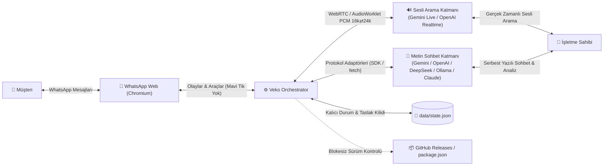

# 🎙️ Veko — WhatsApp Business Sesli ve Yazılı Yapay Zekâ Asistanı

[🇬🇧 English](README.md) | **🇹🇷 Türkçe**

[](https://nodejs.org/)
[](#desteklenen-yapay-zekâ-sağlayıcıları)
[](#desteklenen-yapay-zekâ-sağlayıcıları)
[](#mimari)
[](LICENSE)

> **Dil Notu:** Veko şu anda **yalnızca Türkçe** için optimize edilmiştir (sistem istemleri, WhatsApp komutları ve `Europe/Istanbul` saat dilimi analizleri). Diğer diller için optimize edildikçe güncellenip paylaşılacaktır.

**Veko**, `whatsapp-web.js`, **Chromium WebRTC / AudioWorklet** ses köprüsü ve **çoklu yapay zekâ sağlayıcı mimarisi** üzerine kurulu, 7/24 çalışan açık kaynaklı WhatsApp Business sesli ve yazılı yönetici asistanıdır.

İşletme hattına bir müşteri yazdığında işletme sahibini (`OWNER_PHONE`) WhatsApp üzerinden sesli arar (veya işletme sahibi kendi hattını aradığında çağrıyı otomatik yanıtlar), okundu bilgisi (mavi tik) göndermeden müşteri geçmişini özetler. Aynı zamanda WhatsApp üzerinden serbest yazılı sohbetle müşteri istatistikleri sunar ve **yalnızca açık sözlü veya 2 adımlı yazılı onay alındığında** mesaj gönderir.

---

## 🧠 Mimari



---

## ✨ Öne Çıkan Özellikler

### 📞 Çift Yönlü WhatsApp Sesli Arama
* **Otomatik Giden Arama:** Uygun bir müşteri mesajı geldiğinde işletme sahibini WhatsApp üzerinden sesli arar (bekleme süresi, yeniden deneme ve işletme sahibi aktif pencere kurallarına uyar).
* **Gelen Aramayı Otomatik Yanıtlama:** İşletme sahibi (`OWNER_PHONE`) kendi numarasından işletme hattını birebir sesli aradığında Veko çağrıyı otomatik açar ve bekleyen/okunmamış sohbetleri raporlar.
* **Sanal Ses Kartı Gerektirmez:** Chromium içine enjekte edilen özel `WebRTC` + `AudioWorklet` ses köprüsüyle doğrudan tarayıcı belleği üzerinden 16 kHz / 24 kHz PCM ses aktarımı yapar.
* **Sadece Metin Modu (`AI_VOICE_PROVIDER=none`):** Sesli aramayı kapatıp Veko'yu yalnızca sessiz bildirim ve yazılı WhatsApp asistanı olarak çalıştırabilirsiniz.

### 💬 Serbest WhatsApp Yazılı Asistan & Müşteri İstatistikleri
* **Dönemsel Müşteri Analizi (`get_customer_stats`):** WhatsApp'tan yazarak *"Bu ay kaç müşteri geldi?"*, *"Dün kimler yazdı?"*, *"Okunmamış mesaj var mı?"* gibi soruları Türkiye saatine (`Europe/Istanbul`) göre yanıtlar; giden-tek-yönlü sohbetleri ve aktif tedarikçileri hariç tutar.
* **Sohbet Geçmişi & Kişi Arama:** `search_contacts`, `list_recent_chats` ve `get_chat_history` araçlarıyla okundu bilgisi göndermeden arama ve özetleme yapar.
* **Hızlı Komutlar:** `durum`, `ara`, `ara <isim veya numara>`, `sustur <dk>` ve `devam` komutları yapay zekâya gitmeden anında çalışır.

### 🔒 Güvenlik, Gizlilik ve Akıllı Bildirimler
* **"Mavi Tik" Göndermeden Okuma (Stealth Read):** Ne normal dinlemede ne de müşteri istatistik taramasında `sendSeen()` çağrılmaz.
* **Sesli Görüşmede Sözlü Onay Kilidi:** Canlı aramada yapay zekâ, alıcıyı ve mesaj metnini sesli okuyup açık sözlü onay (`ownerConfirmed: true`) almadan `send_whatsapp_message` aracını çalıştıramaz; her gönderim sonrası işletme sahibine denetim mesajı düşer.
* **Kod Seviyesinde 2 Adımlı Yazılı Onay Kilidi:** Yazılı sohbette model ilk turda asla dış mesaj gönderemez. Önce 15 dakikalık geçici taslağı (`pendingOutgoingDraft`) diske kilitler, alıcıyı ve tam mesaj metnini gösterir; yalnızca bir sonraki mesajınızda alıcı + metin eşleşen açık yazılı onay geldiğinde gönderim yapar.
* **Sağlam `@lid` Kimlik Doğrulama:** WhatsApp `@lid` kimliklerini ters `OWNER_PHONE` eşleştirmesiyle doğrular; çözümlenemeyen yabancı `@lid` aramaları açılmaz.
* **Rahatsız Etmeyen Güncelleme Bildirimleri:** İlk kurulumda tek seferlik bilgilendirme mesajı atar, yeniden başlatmalarda **15 dakikalık spam koruması** uygular ve 7/24 çalışmada gece yarısı asla mesaj atmaz — yeni sürüm bildirimini yalnızca cevaplanan bir sesli görüşme veya yazılı sohbet tamamlandığında iletir (*"Güncelleme bildirimi kapat"* diyerek veya doğal dille kapatılabilir).
* **Grup ve Kanal Koruması:** Grup (`@g.us`), durum (`status@broadcast`), yayın listesi ve bülten (`@newsletter`) sohbetleri yoksayılır.

---

## 🤖 Desteklenen Yapay Zekâ Sağlayıcıları

Veko, varsayılan kurulumda tek `GEMINI_API_KEY` ile **Google Gemini** (`gemini-3.8-live` ses + `gemini-3.8-flash` metin) kullanır; ek SDK yüklemeye gerek kalmadan `.env` üzerinden diğer sağlayıcılara geçilebilir:

### Sesli Arama Sağlayıcıları (`AI_VOICE_PROVIDER`)
| Sağlayıcı | Varsayılan Model | Gerekli Anahtar | Notlar |
| --- | --- | --- | --- |
| `gemini` *(Önerilen)* | `gemini-3.8-live` | `GEMINI_API_KEY` (veya `AI_VOICE_API_KEY`) | Google Gemini Live API (`v1beta` / `BidiGenerateContent`) |
| `openai` | `gpt-realtime-2.1` | `OPENAI_API_KEY` (veya `AI_VOICE_API_KEY`) | OpenAI Realtime WebSocket |
| `none` | — | Yok | Sesli aramalar kapanır; müşteri mesajları sessiz bildirilir ve yazılı asistan aktif kalır |

### Metin Sohbet Sağlayıcıları (`AI_TEXT_PROVIDER`)
| Sağlayıcı | Protokol | Varsayılan Model | Gerekli Anahtar / Adres |
| --- | --- | --- | --- |
| `gemini` *(Önerilen)* | `gemini` | `gemini-3.8-flash` | `GEMINI_API_KEY` (veya `AI_TEXT_API_KEY`) |
| `openai` | `openai-compatible` | `gpt-4o` | `OPENAI_API_KEY` (veya `AI_TEXT_API_KEY`) |
| `deepseek` | `openai-compatible` | `deepseek-v4-flash` | `DEEPSEEK_API_KEY` (veya `AI_TEXT_API_KEY`) |
| `ollama` | `openai-compatible` | `qwen3:8b` | Yerel (`http://localhost:11434/v1`) anahtarsız; bulut uç noktada `OLLAMA_API_KEY` |
| `anthropic` | `anthropic` | `claude-sonnet-4-5` | `ANTHROPIC_API_KEY` (veya `AI_TEXT_API_KEY`) |
| `groq` | `openai-compatible` | `llama-3.3-70b-versatile` | `GROQ_API_KEY` (veya `AI_TEXT_API_KEY`) |
| `xai` | `openai-compatible` | `grok-4.7` | `XAI_API_KEY` (veya `AI_TEXT_API_KEY`) |
| `openrouter` | `openai-compatible` | `openai/gpt-4o-mini` | `OPENROUTER_API_KEY` (veya `AI_TEXT_API_KEY`) |
| `openai-compatible` | `openai-compatible` | *(Zorunlu: `AI_TEXT_MODEL`)* | `AI_TEXT_BASE_URL` + isteğe bağlı `AI_TEXT_API_KEY` |
| `none` | — | — | Yazılı AI yanıtlarını kapatır; hızlı komutlar ve güncelleme bildirimi kontrolü çalışmaya devam eder |

---

## 🚀 Kurulum

### Gereksinimler
* **Node.js `>= 22.0.0`** (yerleşik `fetch` ve ESM)
* **Google Chrome** veya **Microsoft Edge** *(Canlı WhatsApp WebRTC sesli aramaları için masaüstü/GUI oturumu ve `CHROME_HEADLESS=false` gerekir; `AI_VOICE_PROVIDER=none` modunda headless çalışabilir)*
* Seçtiğiniz sağlayıcıya ait API anahtarı *(veya yalnızca metin sohbeti için yerel **Ollama**)*
* İki WhatsApp hattı: Veko'nun bağlanacağı **İşletme Hattı** ve işletme sahibinin **Kişisel WhatsApp Numarası** (`OWNER_PHONE`)

### Kurulum Adımları

```powershell
git clone https://github.com/holy2k/veko.git
cd veko
npm install
Copy-Item .env.example .env
```

Önerilen Google Gemini kurulumu için `.env` içinde şu iki satırı doldurmanız yeterlidir:

```env
OWNER_PHONE=905XXXXXXXXX
GEMINI_API_KEY=AIza...
```

<details>
<summary>Tüm Ortam Değişkenleri Referansı</summary>

| Değişken | Varsayılan | Açıklama |
| --- | --- | --- |
| `OWNER_PHONE` | *(zorunlu)* | İşletme sahibinin telefon numarası (örn. `905XXXXXXXXX`) |
| `ASSISTANT_NAME` | `Veko` | Asistan adı |
| `ASSISTANT_STYLE` | *(boş)* | İsteğe bağlı iletişim tonu yönergesi |
| `AI_VOICE_PROVIDER` | `gemini` | `gemini`, `openai` veya `none` |
| `AI_VOICE_MODEL` | Sağlayıcıya bağlı | Ses modeli geçersiz kılma (`GEMINI_LIVE_MODEL` / `OPENAI_REALTIME_MODEL` desteklenir) |
| `AI_VOICE_NAME` / `TTS_VOICE_NAME` | `Aoede` / `cedar` | Ses profili (Gemini: `Puck`, `Charon`, `Fenrir`, `Aoede`, `Kore`; OpenAI: `cedar`, `alloy`, vb.) |
| `AI_TEXT_PROVIDER` | `gemini` | Metin sohbet sağlayıcısı |
| `AI_TEXT_MODEL` | Sağlayıcıya bağlı | Metin modeli geçersiz kılma (`GEMINI_TEXT_MODEL` / `OLLAMA_MODEL` desteklenir) |
| `AI_TEXT_BASE_URL` | Sağlayıcıya bağlı | Özel API / Ollama / OpenAI uyumlu uç nokta |
| `CHROME_HEADLESS` | `new` | Canlı sesli arama için `false` önerilir |
| `CHROME_EXECUTABLE_PATH` | *(otomatik)* | Özel Chrome/Edge yürütülebilir dosya yolu |
| `CALL_RING_TIMEOUT_SEC` | `35` | Çalma zaman aşımı (saniye) |
| `CALL_MAX_DURATION_SEC` | `300` | Maksimum arama süresi (saniye) |
| `COOLDOWN_MINUTES` | `120` | Cevaplanan arama veya onaylı yazılı yanıt sonrası bekleme süresi (dk) |
| `MISSED_RETRY_MINUTES` | `30` | Cevapsız çağrıdan sonra tek otomatik yeniden deneme bekleme süresi (dk) |
| `OWNER_ACTIVE_WINDOW_MINUTES` | `15` | İşletme sahibi sohbete manuel yanıt verirse arama baskılama penceresi (dk) |
| `THIRD_PARTY_OUTREACH_HOURS` | `24` | Üçüncü şahsa giden onaylı mesaj sonrası sessiz bildirim penceresi (saat) |
| `STATE_FILE_PATH` | `./data/state.json` | Kalıcı sohbet, geçmiş, taslak ve güncelleme durumu dosyası |
| `GITHUB_REPO_URL` | `https://github.com/holy2k/veko` | İsteğe bağlı depo bağlantısı |
| `UPDATE_CHECK_URL` | `https://raw.githubusercontent.com/holy2k/veko/main/package.json` | İsteğe bağlı sürüm kontrol adresi |

</details>

---

## 📱 Çalıştırma ve Kullanım

```powershell
npm start
```

1. Terminalde basılan QR kodunu işletme hattının bağlı olduğu WhatsApp telefonundan **Bağlı Cihazlar → Cihaz Bağla** ile okutun.
2. `[Veko] WhatsApp Web HAZIR. Mesajlar dinleniyor...` çıktısı göründüğünde Veko `OWNER_PHONE` numarasına tek seferlik kurulum onay mesajı gönderir.
3. Yeni sürümlerden e-posta/bildirim ile haberdar olmak için sayfanın sağ üstünden **Watch → Custom → Releases** seçeneğini açabilirsiniz.

### Hızlı WhatsApp Komutları (İşletme Sahibinden)
* `durum` — Aktif/susturulmuş durum, aktif/bekleyen arama, sürüm ve güncelleme bildirimi durumunu gösterir.
* `ara` — Cevapsız/bekleyen son müşteri sohbeti için sesli arama başlatır.
* `ara <isim veya numara>` — Eşleşen kişi için bağlam yükleyip sesli arama başlatır.
* `sustur <dakika>` — Sesli aramaları belirtilen dakika boyunca susturur (varsayılan `60` dk).
* `devam` — Susturmayı hemen kaldırır.

Komut dışındaki tüm mesajlarınız doğrudan Veko metin asistanına yönlendirilir *(ör. müşteri sayımı, sohbet özeti, onay kilitli mesaj gönderimi veya "güncelleme bildirimi kapat/aç" gibi doğal dil istekleri)*.

---

## 🖥️ Windows VDS (7/24) Kurulumu

Uzak masaüstü (RDP) bağlantısı kapatıldığında Chrome WebRTC ses köprüsünün durmaması için:

```powershell
powershell -ExecutionPolicy Bypass -File scripts/vds-setup.ps1 -InstallPm2 -RegisterScheduledTask
```

RDP penceresini oturumu kilitlemeden kapatmak için [scripts/disconnect-rdp.bat](scripts/disconnect-rdp.bat) dosyasını **Yönetici olarak** çalıştırın (`tscon %SESSIONNAME% /dest:console`).

---

## 🧪 Test ve Tanılama

```powershell
# Çevrimdışı birim test paketi
npm test

# WebRTC / sesli arama DOM & Worklet test spike'ı
npm run spike
```

---

## ⚠️ Sorumluluk Reddi (Disclaimer)

- **Resmî Bağlantı Yoktur:** Bu proje eğitim ve açık kaynak geliştirme amacıyla hazırlanmıştır. **WhatsApp**, **Meta Platforms Inc.**, **Google**, **OpenAI** veya diğer yapay zekâ sağlayıcılarıyla herhangi bir resmî bağı, ortaklığı ya da onayı yoktur.
- **Hesap ve Hizmet Şartları Riski:** Veko, resmî WhatsApp Business API yerine `whatsapp-web.js` aracılığıyla WhatsApp Web otomasyonu kullanır. Kullanım şekline bağlı olarak WhatsApp Hizmet Şartları ihlali, numara kısıtlaması veya hesap askıya alınması gibi durumlardan doğabilecek hiçbir sonuçtan proje geliştiricileri sorumlu tutulamaz.
- **Veri Gizliliği (KVKK / GDPR) ve API Maliyetleri:** Kullanıcının seçtiği bulut yapay zekâ sağlayıcılarına iletilen ses/metin verilerinin hukuki uygunluğu (KVKK/GDPR aydınlatma yükümlülükleri dahil) ve oluşan API kullanım ücretleri tamamen sistemi kuran ve çalıştıran kullanıcıya aittir.
- **Yapay Zekâ Çıktıları ve Onay:** Veko sözlü ve 2 adımlı yazılı onay mekanizmaları sunsa da, yapay zekâ modellerinin üreteceği hatalı özetlerden veya kullanıcının onaylayarak gönderdiği mesajların sonuçlarından kullanıcı sorumludur.
- **Garanti Reddi:** Yazılım, [MIT Lisansı](LICENSE) kapsamında **"OLDUĞU GİBİ" (AS IS)** sunulur; ticari elverişlilik veya belirli bir amaca uygunluk garantisi vermez.

---

## 📄 Lisans

[MIT Lisansı](LICENSE) altında lisanslanmıştır — Copyright (c) 2026 Hamza Mert Akboz.
